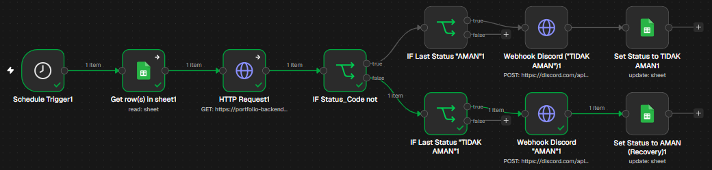
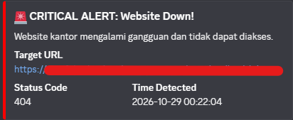
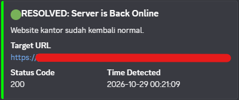

# Automated Website Uptime Monitor with State Management

> A robust, production-grade infrastructure health monitoring workflow built with **n8n**, **Google Sheets**, and **Discord Webhooks**. Features intelligent alert deduplication to prevent alert fatigue.

---

## Background of the issue

The office website/server frequently goes down outside of working hours, and the IT team only finds out after receiving complaints from clients or the boss.

---

## Overview

Monitoring server downtime shouldn't cause **Alert Fatigue** for IT teams. Many basic monitors spam alerts every minute when a system is down. 

This project solves that issue by implementing **State Management** using Google Sheets as a temporary state store. The system only alerts the team on **state transitions**:
1. When an incident occurs (`UP` to `DOWN`)
2. When the system recovers (`DOWN` to `UP`)

---

## Workflow Architecture



### Incident & Recovery Alerts in Discord
| Incident Alert (Red) | Recovery Alert (Green) |
| :---: | :---: |
|  |  |

---

## How It Works (State Logic)

Every 1-5 minutes, the workflow executes the following state matrix:

| Previous State (Sheet) | Current Check (HTTP) | Action Taken | Discord Alert |
| :--- | :--- | :--- | :--- |
| **AMAN** | `HTTP != 200` (Down) | Update Sheet to `TIDAK AMAN` | 🔴 **Send RED Alert** |
| **TIDAK AMAN** | `HTTP != 200` (Down) | Nothing |  *Muted (No Spam)* |
| **TIDAK AMAN** | `HTTP == 200` (Up) | Update Sheet to `AMAN` | 🟢 **Send GREEN Alert** |
| **AMAN** | `HTTP == 200` (Up) | Nothing |  *Muted (Normal)* |

---

## Tech Stack & Tools

- **Container:** [Docker](https://www.docker.com/)
- **Workflow Automation:** [n8n](https://n8n.io/)
- **State Store:** Google Sheets API
- **Target Health-check:** REST API Endpoint or Home Page Link
- **Incident Channel:** Discord Webhook API

---

## How to Use / Import

1. Clone this repository:
   ```bash
   git clone https://github.com/username/n8n-uptime-monitoring.git
2. Open your self-hosted n8n instance.
3. Go to Workflows ➔ Import from File, select workflows/uptime-monitor.json.
4. Configure :
   - Insert your web link (API Endpoint or Homepage).
   - Google Sheets OAuth2 Account.
   - Replace Discord Webhook URL with your own.
6. Setup your Google Sheet with columns: status_terakhir, waktu_update, row_number.
7. Run.

---

## Author
Hidayatul Hayat - [LinkedIn](https://www.linkedin.com/in/hidayatul-hayat-s-kom-441b6b278) - [Portofolio](https://portfolio-backend-frontend-murex.vercel.app/)

---
